> ⚠️ **退役说明**：本文引用的 `engine/src/db/`（PostgreSQL 风格 CMake 内核）已于 **2026-11-18 退役**，源码、公开头与测试全部删除；文中出现的 `engine/src/db/...`、`engine/include/db/...`、`engine/test/db/...` 路径均为**历史路径**，现已不存在。
> 当前唯一数据库内核是 `engine/db/`。

# 索引系统 - 架构设计

## 概述

索引系统管理所有索引类型，包括传统索引（B+树、哈希、位图、GIN、GiST 等）和向量索引（HNSW、IVF、DiskANN、PQ 等 33 种），提供统一的索引创建、查询、维护和持久化接口。

---

## 一、子系统架构概览

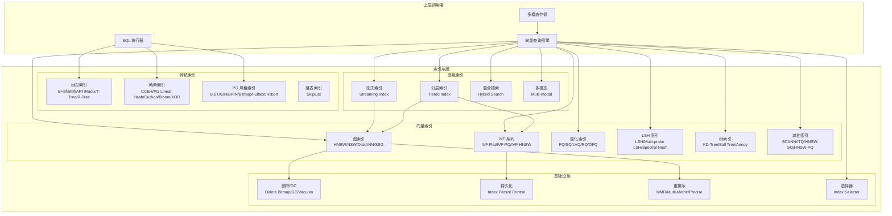

---

## 二、传统索引

### 2.1 传统索引分类

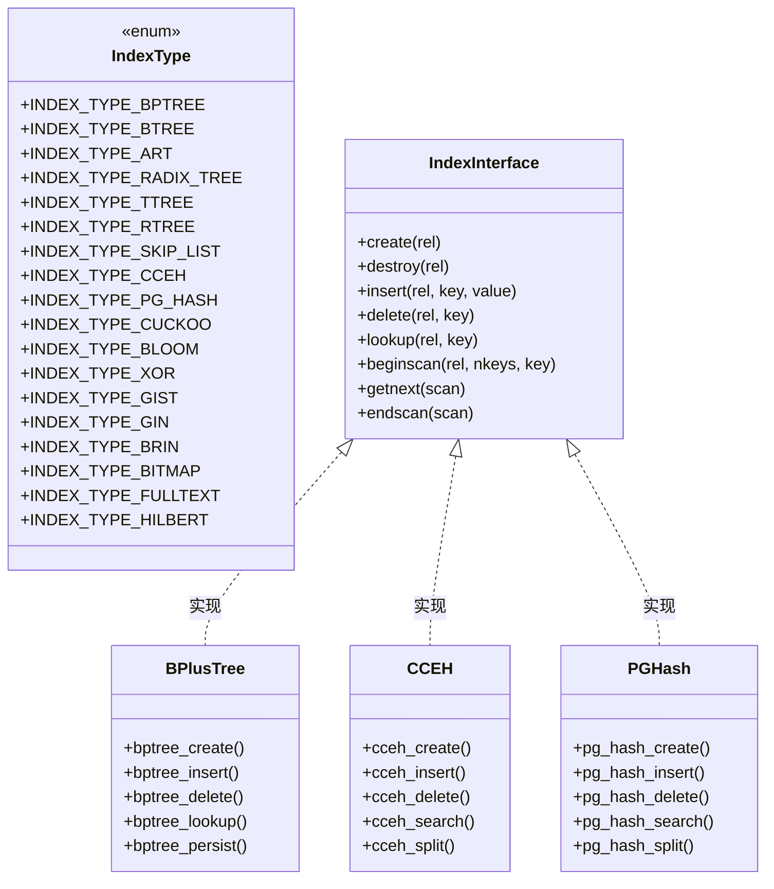

### 2.2 树形索引

| 索引类型 | 文件 | 核心特性 | 典型场景 |
|---------|------|---------|---------|
| **B+树** | `bplus_tree/bptree.h` | 有序、范围扫描、持久化 | 主键索引、聚簇索引 |
| **B树** | `btree/btree.h` | 有序、内部节点也存数据 | 文件系统目录 |
| **ART** | `art/art.h` | 自适应基数树、前缀压缩 | 字符串索引（URL、IP） |
| **Radix Tree** | `radix_tree/radix_tree.h` | 基数树、按位比较 | IP 路由、前缀匹配 |
| **T-Tree** | `ttree/ttree.h` | 平衡树、内存优化 | 内存数据库索引 |
| **R-Tree** | `rtree/rtree.h` | 空间范围搜索 | GIS 边界框查询 |
| **Skip List** | `skip_list/skip_list.h` | 概率平衡、支持并发 | 内存 KV 排序索引 |

### 2.3 哈希索引

| 索引类型 | 文件 | 核心特性 | 典型场景 |
|---------|------|---------|---------|
| **CCEH** | `hash/cceh.h` | 可扩展哈希、分段扩展 | 高并发 KV 存储 |
| **PG Linear Hash** | `hash/pg_hash.h` | 线性哈希、增量分裂 | 哈希索引 |
| **Cuckoo** | `hash/cuckoo.h` | 布谷鸟哈希、O(1) 最坏 | 精确查找 |
| **Bloom** | `hash/bloom.h` | 布隆过滤器、概率性 | 存在性检查 |
| **XOR Filter** | `hash/xor_filter.h` | XOR 过滤器、紧凑 | 空间敏感场景 |

### 2.4 PG 风格索引

| 索引类型 | 文件 | 核心特性 | 典型场景 |
|---------|------|---------|---------|
| **GiST** | `gist/gist.h` | 通用搜索树、可扩展 | 全文搜索、空间搜索 |
| **GIN** | `gin/gin.h` | 倒排索引、多值键 | 全文搜索、JSONB |
| **BRIN** | `brin/brin.h` | 块范围索引、压缩 | 大表顺序数据 |
| **Bitmap** | `bitmap/bitmap_index.h` | 位图索引 | 低基数列 |
| **Fulltext** | `fulltext/fulltext.h` | 全文检索 | 文本搜索 |
| **Hilbert** | `hilbert.h` | 希尔伯特曲线 | 多维空间排序 |

---

## 三、向量索引

### 3.1 向量索引架构

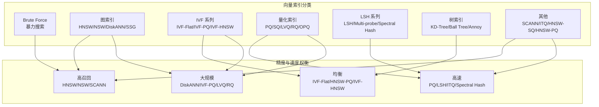

### 3.2 图索引

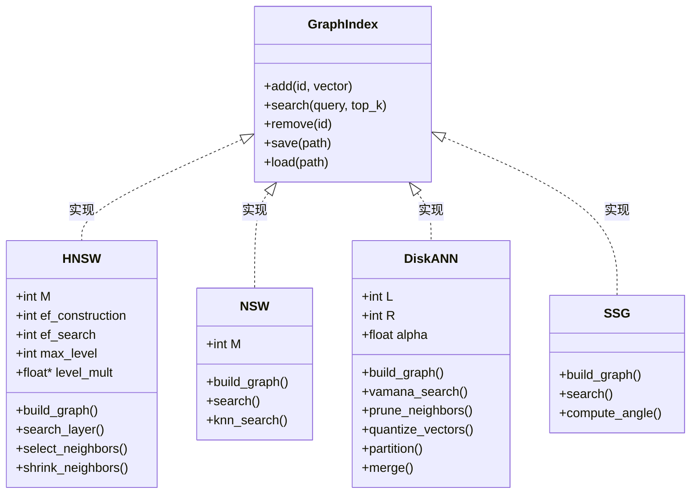

### 3.3 HNSW 插入流程

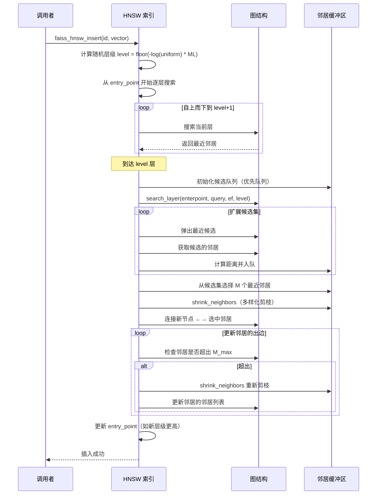

### 3.4 IVF 系列

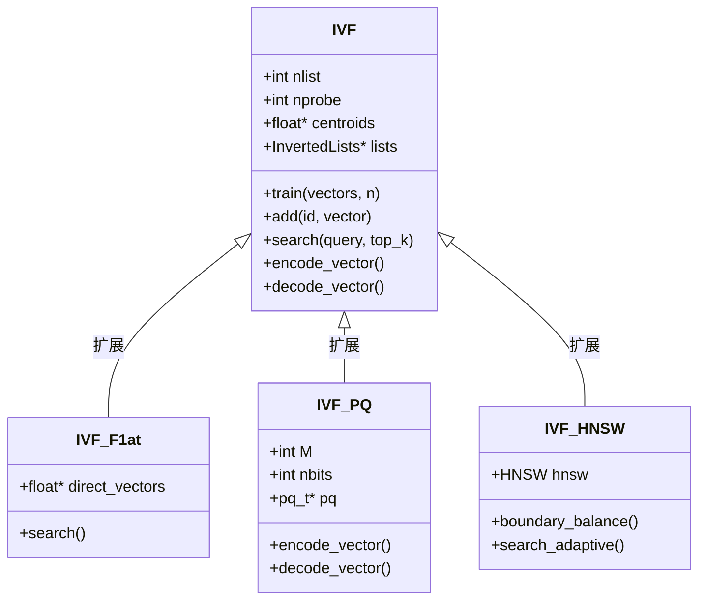

### 3.5 量化索引

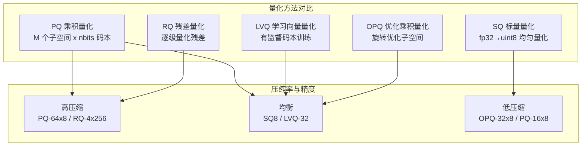

### 3.6 向量索引速查表

| 类别 | 索引 | 文件 | 搜索复杂度 | 精度 | 构建时间 |
|------|------|------|-----------|------|---------|
| **图** | HNSW | `hnsw/faiss_hnsw.h` | O(log N) | ★★★★★ | ★★★☆☆ |
| **图** | NSW | `nsw/nsw.h` | O(log N) | ★★★★☆ | ★★★☆☆ |
| **图** | DiskANN | `diskann/diskann.h` | O(log N) | ★★★★☆ | ★★★★★ |
| **图** | SSG | `ssg/ssg.h` | O(log N) | ★★★★☆ | ★★★★☆ |
| **IVF** | IVF-Flat | `ivf_flat/ivf_flat.h` | O(nlist/nprobe) | ★★★★☆ | ★★★☆☆ |
| **IVF** | IVF-PQ | `ivf_pq/ivf_pq.h` | O(nlist/nprobe) | ★★★☆☆ | ★★★★☆ |
| **IVF** | IVF-HNSW | `ivf_hnsw/ivf_hnsw.h` | O(log N) | ★★★★★ | ★★★★☆ |
| **量化** | PQ | `pq/pq.h` | O(M) | ★★★☆☆ | ★★★★☆ |
| **量化** | SQ | `sq/sq.h` | O(d) | ★★★☆☆ | ★☆☆☆☆ |
| **量化** | LVQ | `lvq/lvq.h` | O(d) | ★★★★☆ | ★★★★☆ |
| **量化** | RQ | `rq/rq.h` | O(M) | ★★★★☆ | ★★★★★ |
| **量化** | OPQ | `opq/opq.h` | O(M) | ★★★★☆ | ★★★★★ |
| **LSH** | LSH | `lsh/lsh.h` | O(1) | ★★☆☆☆ | ★★☆☆☆ |
| **LSH** | Multi-probe LSH | `lsh_multiprobe/lsh_multiprobe.h` | O(1) | ★★★☆☆ | ★★☆☆☆ |
| **LSH** | Spectral Hash | `spectral_hash/spectral_hash.h` | O(k) | ★★★☆☆ | ★★★★☆ |
| **树** | KD-Tree | `kd_tree/kd_tree.h` | O(log N) | ★★★★☆ | ★★★☆☆ |
| **树** | Ball Tree | `ball_tree/ball_tree.h` | O(log N) | ★★★★☆ | ★★★☆☆ |
| **树** | Annoy | `annoy/annoy.h` | O(log N) | ★★★☆☆ | ★★★★☆ |
| **其他** | SCANN | `scann/scann.h` | O(M) | ★★★★☆ | ★★★★★ |
| **其他** | ITQ | `itq/itq.h` | O(k) | ★★★☆☆ | ★★★★☆ |
| **其他** | HNSW-SQ | `hnsw_sq/hnsw_sq.h` | O(log N) | ★★★★☆ | ★★★☆☆ |
| **其他** | HNSW-PQ | `hnsw_pq/hnsw_pq.h` | O(log N) | ★★★★☆ | ★★★☆☆ |
| **其他** | BM25 | `BM25/bm25.h` | O(d) | N/A | ★★★★☆ |
| **其他** | Milvus IVF | `milvus_ivf/milvus_ivf.h` | O(nlist/nprobe) | ★★★★☆ | ★★★☆☆ |

---

## 四、高级索引

### 4.1 流式索引

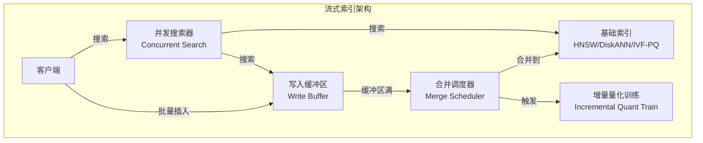

### 4.2 分层索引

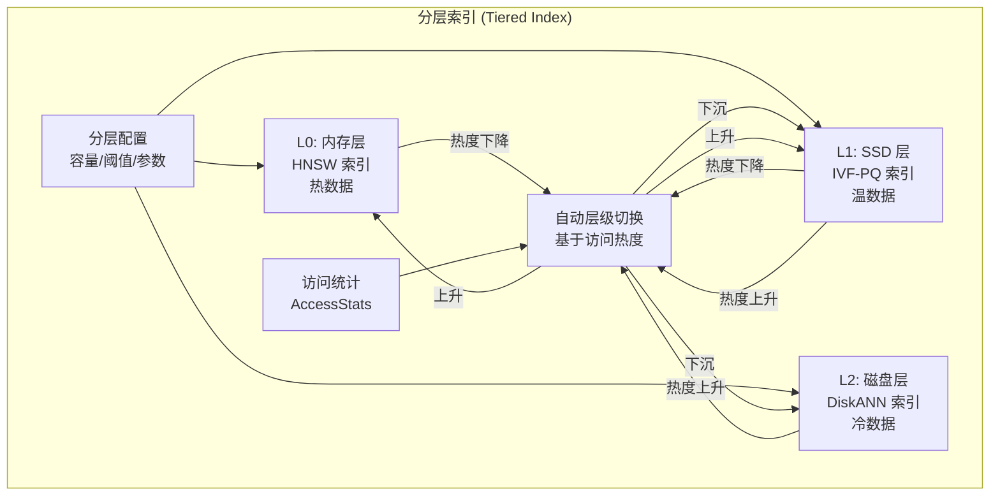

### 4.3 分层索引搜索流程

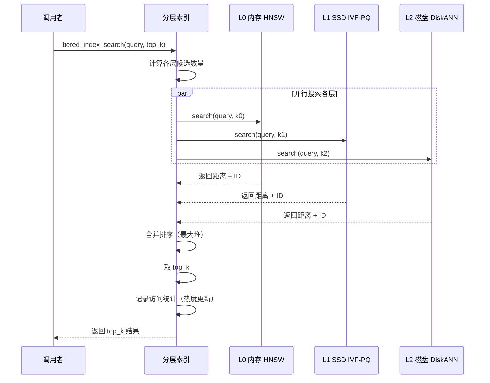

### 4.4 混合搜索

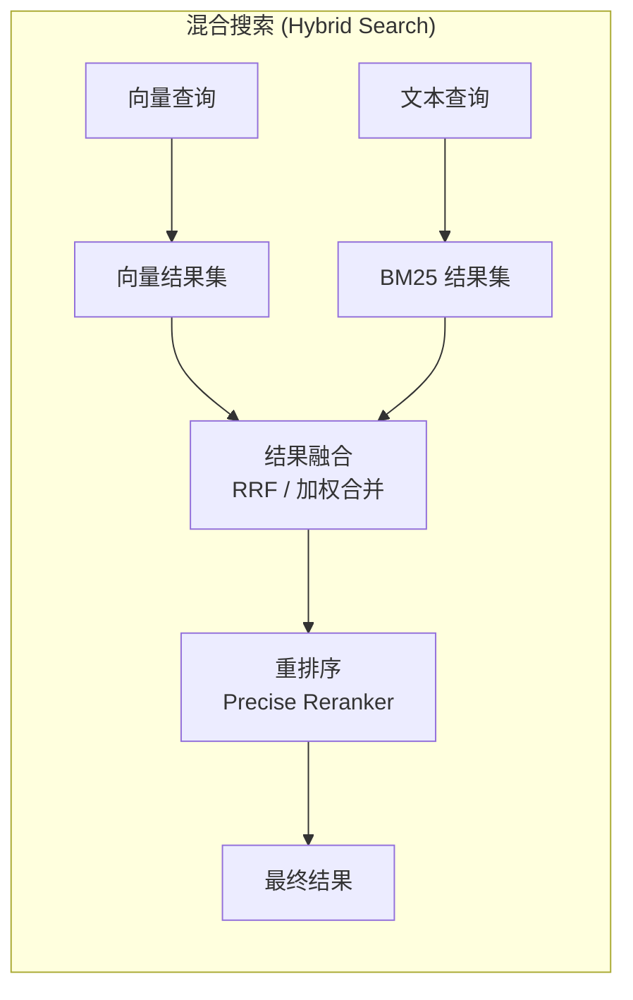

### 4.5 多模态索引

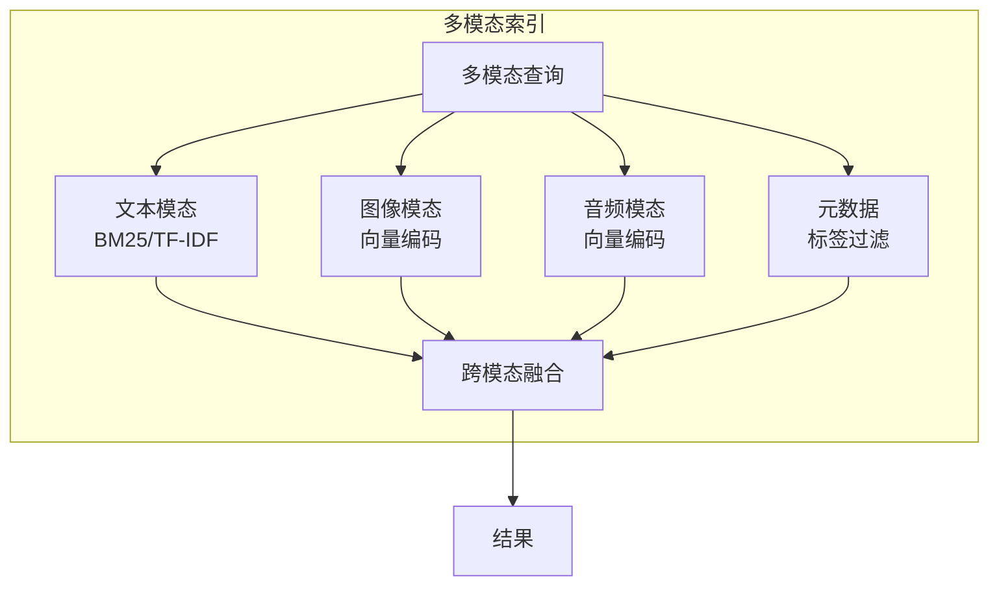

---

## 五、删除与 GC

### 5.1 删除体系

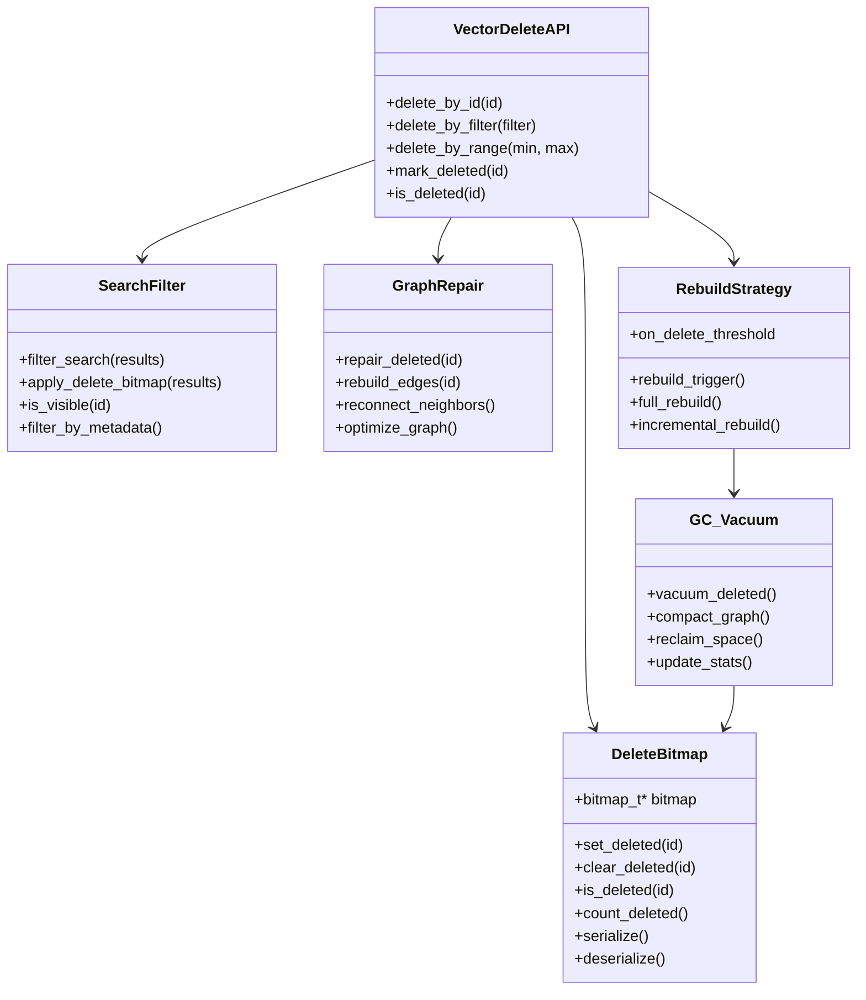

### 5.2 删除与 GC 流程

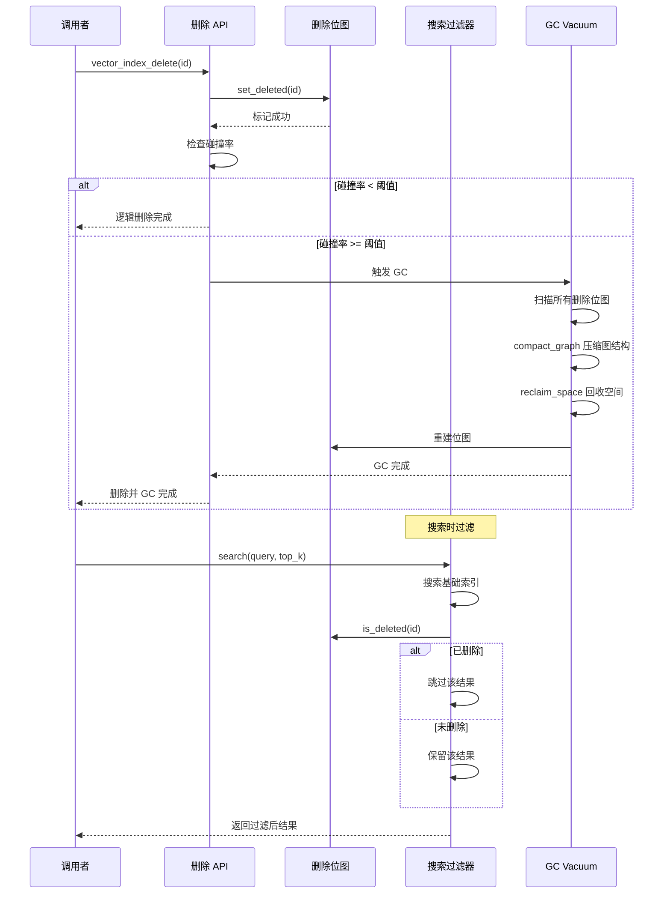

---

## 六、重排序引擎

### 6.1 重排序架构

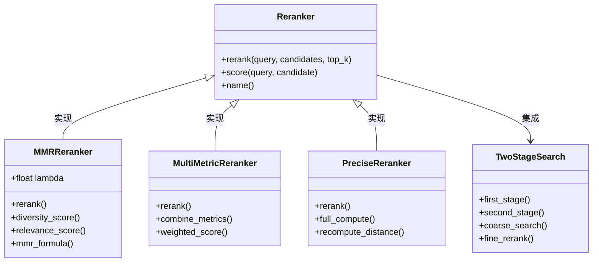

### 6.2 两阶段搜索流程

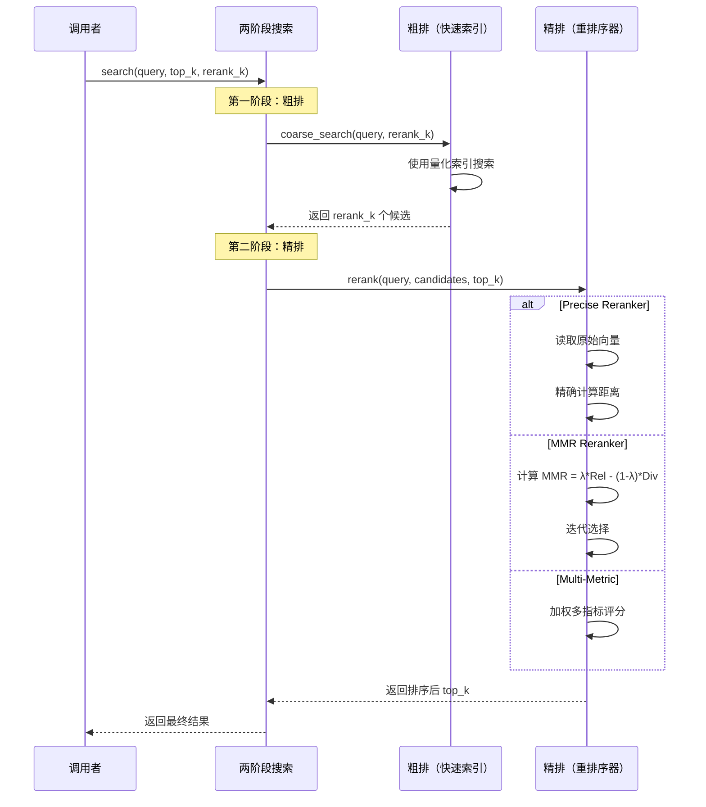

---

## 七、持久化与配置

### 7.1 持久化控制

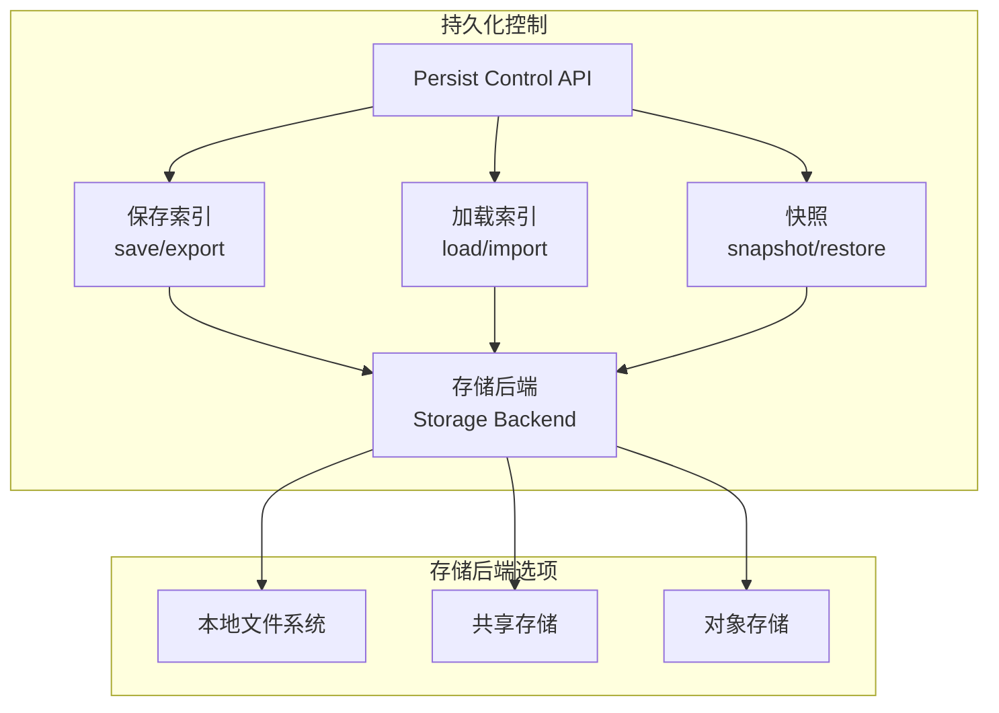

### 7.2 索引配置

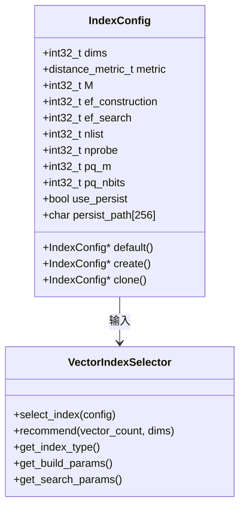

---

## 八、索引选择器

### 8.1 索引选择策略

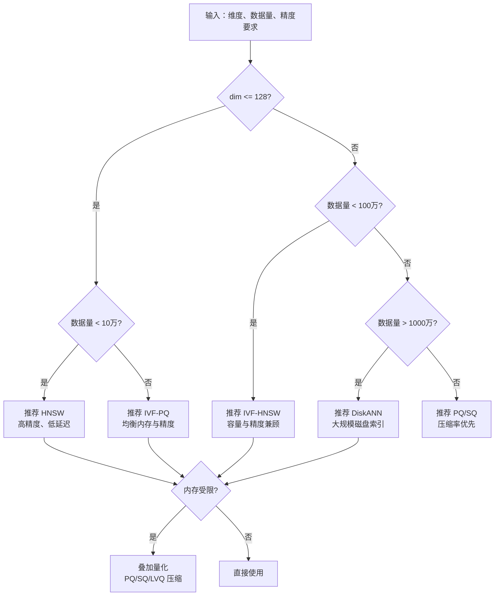

---

## 九、关键代码位置

### 9.1 传统索引

| 索引类型 | 头文件 | 源文件 |
|---------|--------|--------|
| B+树 | `engine/include/db/index/bplus_tree/bptree.h` | `engine/src/db/index/bplus_tree/` |
| B树 | `engine/include/db/index/btree/btree.h` | `engine/src/db/index/btree/` |
| ART | `engine/include/db/index/art/art.h` | `engine/src/db/index/art/` |
| Radix Tree | `engine/include/db/index/radix_tree/radix_tree.h` | `engine/src/db/index/radix_tree/` |
| T-Tree | `engine/include/db/index/ttree/ttree.h` | `engine/src/db/index/ttree/` |
| R-Tree | `engine/include/db/index/rtree/rtree.h` | `engine/src/db/index/rtree/` |
| Skip List | `engine/include/db/index/skip_list/skip_list.h` | `engine/src/db/index/skip_list/` |
| CCEH | `engine/include/db/index/hash/cceh.h` | `engine/src/db/index/hash/cceh/` |
| PG Hash | `engine/include/db/index/hash/pg_hash.h` | `engine/src/db/index/hash/pg_hash/` |
| Cuckoo | `engine/include/db/index/hash/cuckoo.h` | `engine/src/db/index/hash/cuckoo/` |
| Bloom | `engine/include/db/index/hash/bloom.h` | `engine/src/db/index/hash/bloom/` |
| XOR | `engine/include/db/index/hash/xor_filter.h` | `engine/src/db/index/hash/xor_filter/` |
| GiST | `engine/include/db/index/gist/gist.h` | `engine/src/db/index/gist/` |
| GIN | `engine/include/db/index/gin/gin.h` | `engine/src/db/index/gin/` |
| BRIN | `engine/include/db/index/brin/brin.h` | `engine/src/db/index/brin/` |
| Bitmap | `engine/include/db/index/bitmap/bitmap_index.h` | `engine/src/db/index/bitmap/` |
| Fulltext | `engine/include/db/index/fulltext/fulltext.h` | `engine/src/db/index/fulltext/` |
| Hilbert | `engine/include/db/index/hilbert.h` | `engine/src/db/index/hilbert/` |

### 9.2 向量索引

| 索引类型 | 头文件 | 源文件 |
|---------|--------|--------|
| HNSW | `engine/include/db/index/vector_index/hnsw/faiss_hnsw.h` | `engine/src/db/index/vector_index/hnsw/` |
| NSW | `engine/include/db/index/vector_index/nsw/nsw.h` | `engine/src/db/index/vector_index/nsw/` |
| DiskANN | `engine/include/db/index/vector_index/diskann/diskann.h` | `engine/src/db/index/vector_index/diskann/` |
| SSG | `engine/include/db/index/vector_index/ssg/ssg.h` | `engine/src/db/index/vector_index/ssg/` |
| IVF-Flat | `engine/include/db/index/vector_index/ivf_flat/ivf_flat.h` | `engine/src/db/index/vector_index/ivf_flat/` |
| IVF-PQ | `engine/include/db/index/vector_index/ivf_pq/ivf_pq.h` | `engine/src/db/index/vector_index/ivf_pq/` |
| IVF-HNSW | `engine/include/db/index/vector_index/ivf_hnsw/ivf_hnsw.h` | `engine/src/db/index/vector_index/ivf_hnsw/` |
| PQ | `engine/include/db/index/vector_index/pq/pq.h` | `engine/src/db/index/vector_index/pq/` |
| SQ | `engine/include/db/index/vector_index/sq/sq.h` | `engine/src/db/index/vector_index/sq/` |
| LVQ | `engine/include/db/index/vector_index/lvq/lvq.h` | `engine/src/db/index/vector_index/lvq/` |
| RQ | `engine/include/db/index/vector_index/rq/rq.h` | `engine/src/db/index/vector_index/rq/` |
| OPQ | `engine/include/db/index/vector_index/opq/opq.h` | `engine/src/db/index/vector_index/opq/` |
| LSH | `engine/include/db/index/vector_index/lsh/lsh.h` | `engine/src/db/index/vector_index/lsh/` |
| Multi-probe LSH | `engine/include/db/index/vector_index/lsh_multiprobe/lsh_multiprobe.h` | `engine/src/db/index/vector_index/lsh_multiprobe/` |
| Spectral Hash | `engine/include/db/index/vector_index/spectral_hash/spectral_hash.h` | `engine/src/db/index/vector_index/spectral_hash/` |
| KD-Tree | `engine/include/db/index/vector_index/kd_tree/kd_tree.h` | `engine/src/db/index/vector_index/kd_tree/` |
| Ball Tree | `engine/include/db/index/vector_index/ball_tree/ball_tree.h` | `engine/src/db/index/vector_index/ball_tree/` |
| Annoy | `engine/include/db/index/vector_index/annoy/annoy.h` | `engine/src/db/index/vector_index/annoy/` |
| SCANN | `engine/include/db/index/vector_index/scann/scann.h` | `engine/src/db/index/vector_index/scann/` |
| ITQ | `engine/include/db/index/vector_index/itq/itq.h` | `engine/src/db/index/vector_index/itq/` |
| HNSW-SQ | `engine/include/db/index/vector_index/hnsw_sq/hnsw_sq.h` | `engine/src/db/index/vector_index/hnsw_sq/` |
| HNSW-PQ | `engine/include/db/index/vector_index/hnsw_pq/hnsw_pq.h` | `engine/src/db/index/vector_index/hnsw_pq/` |
| BM25 | `engine/include/db/index/vector_index/BM25/bm25.h` | `engine/src/db/index/vector_index/BM25/` |
| Milvus IVF | `engine/include/db/index/vector_index/milvus_ivf/milvus_ivf.h` | `engine/src/db/index/vector_index/milvus_ivf/` |

### 9.3 高级索引及基础设施

| 功能 | 头文件 | 源文件 |
|------|--------|--------|
| 流式索引 | `engine/include/db/index/vector_index/streaming/streaming_index.h` | `engine/src/db/index/vector_index/streaming/` |
| 分层索引 | `engine/include/db/index/vector_index/tiered_index.h` | `engine/src/db/index/vector_index/tiered_index.c` |
| 混合搜索 | `engine/include/db/index/vector_index/hybrid_search.h` | `engine/src/db/index/vector_index/hybrid_search.c` |
| 多模态 | `engine/include/db/index/vector_index/multimodal/multimodal.h` | `engine/src/db/index/vector_index/multimodal/` |
| 删除/GC | `engine/include/db/index/vector_index/delete/vector_index_delete_api.h` | `engine/src/db/index/vector_index/delete/` |
| 重排序 | `engine/include/db/index/vector_index/reranker/reranker.h` | `engine/src/db/index/vector_index/reranker/` |
| 持久化 | `engine/include/db/index/index_persist_control.h` | `engine/src/db/index/` |
| 配置 | `engine/include/db/index/index_config.h` | `engine/src/db/index/` |
| 选择器 | `engine/include/db/index/vector_index/vector_index_selector.h` | `engine/src/db/index/vector_index/` |
| 存储后端 | `engine/include/db/index/storage_backend.h` | `engine/src/db/index/` |
| 向量引用 | `engine/include/db/index/vector_ref.h` | `engine/src/db/index/` |
| C API | `engine/include/db/index/vector_index/vector_index_c_api.h` | `engine/src/db/index/vector_index/` |